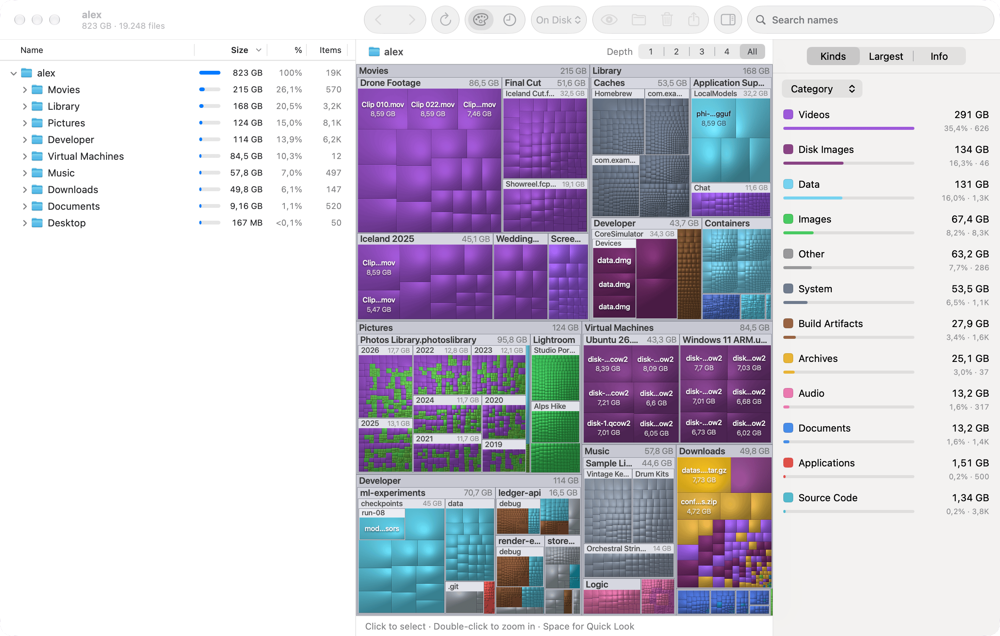

My Mac was full, and Disk Inventory X no longer works on the newest macOS. Fable 5.2 made this app with basically no more input than “make a better, faster, modern disk inventory x”.

It's available on [GitHub](https://github.com/dwahdany/disk-survey) and [TestFlight](https://testflight.apple.com/join/ku8sJmCv).

The more AGI-pilled approach would be to have Claude clean up my Mac for me, I guess, but I don't like that (yet).
