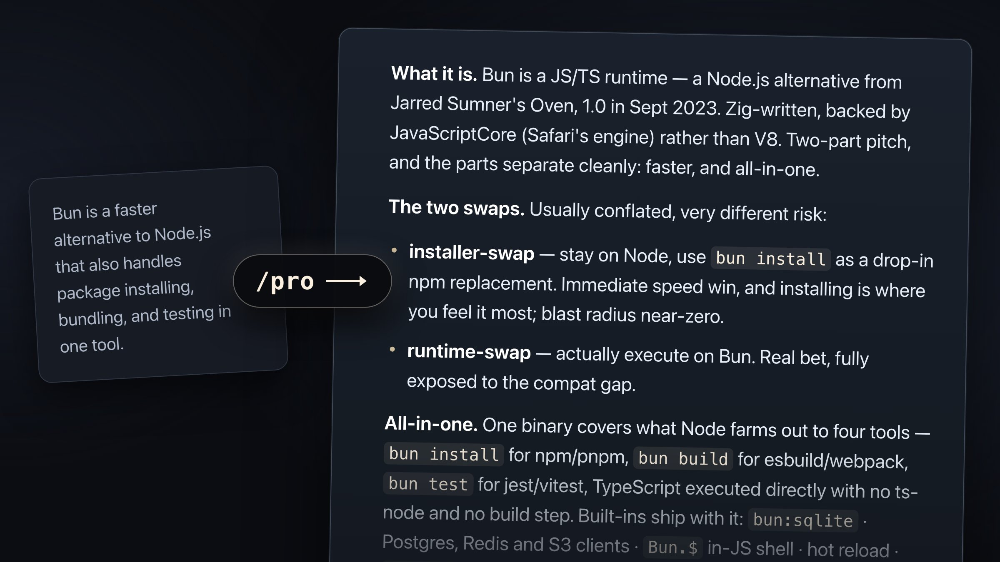

Are you also scared of Opus 5 sometimes producing actually comprehensible text? Not to worry!

Introducing the /pro skill (opposite of /bro)

For the rare occasion you get plain and understandable text, /pro will transform it into pithy and compendious output—replete with the staccato cadence and load-bearing-hyphen-stacks you rightfully expect.

[Available on GitHub.](https://github.com/dwahdany/claude-skills/blob/main/pro/SKILL.md)

Inspired by /bro, which is actually really useful https://x.com/dillon_mulroy/
status/2079257150824620312?s=20
 
(/pro, on the other hand, is utterly useless)
